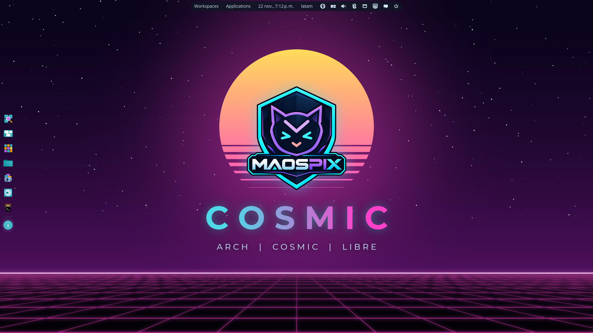
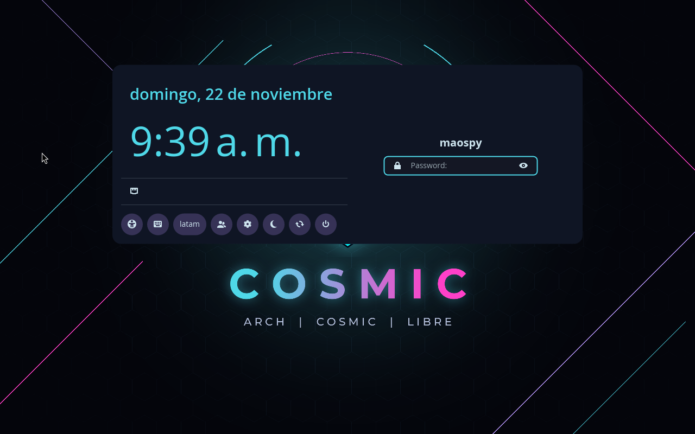
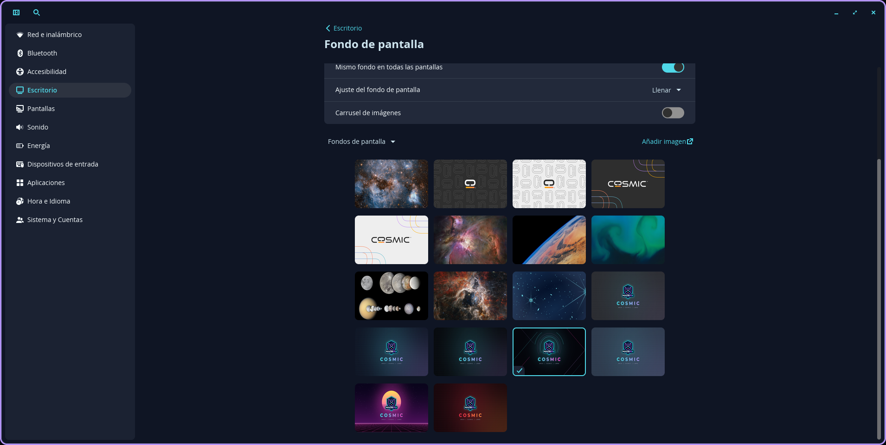
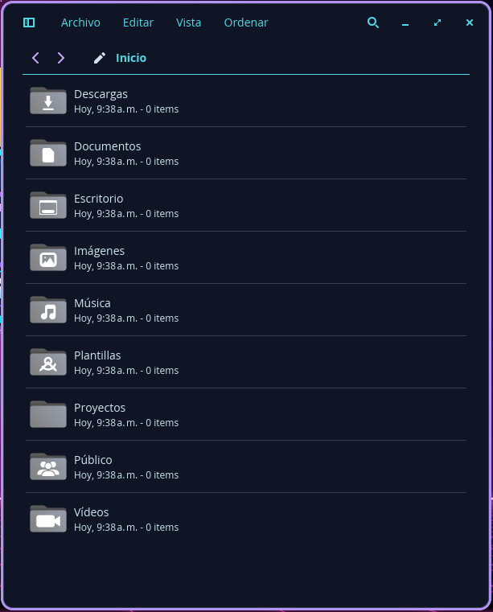
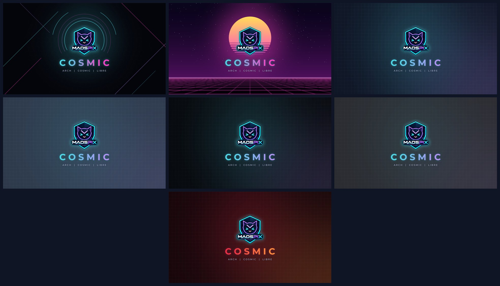

# MAOSPIX-COSMIC

Distro basada en **Arch Linux** con el escritorio **COSMIC** y la identidad
visual MAOSPIX (navy, cian y violeta), todo preinstalado y tematizado.
Parte de la familia maospix.

> Estado: **versión 1.0** (Prueba 5).



## Descargar

Descargá la ISO (3,7 GB) desde
[SourceForge](https://sourceforge.net/projects/maospix-cosmic/files/maospix-cosmic-2026.11.25-x86_64.iso/download)
y verificá el checksum:

```
sha256sum maospix-cosmic-2026.11.25-x86_64.iso
9670498f3e5b1e9da22e6e9c60c643bfe989c47ae4883049b2c5101c31ae82f1
```

1. Grabala en un pendrive (Ventoy, `dd` o Balena Etcher) o usala en una VM.
2. Arrancá el live y abrí el instalador (Calamares, en español).

En VirtualBox conviene activar **EFI** y la **aceleración 3D** con 256 MB de
video. Sin 3D también funciona, pero el movimiento es menos fluido.

## Qué trae

- COSMIC con mosaico automático, barra superior flotante y dock transparente.
- Siete fondos propios y tema oscuro con tonalidad violeta.
- kitty con fish y fastfetch con el logo MAOSPIX.
- Brave, OnlyOffice, Loupe (imágenes) y la tienda COSMIC con Flatpak.
- Para programar: Code - OSS, Node.js, PHP, MariaDB, Docker, Codex, OpenCode y Herdr.
- AUR con `paru`, `yay` y Shelly.
- Instalación con Btrfs, snapshots con Snapper y arranque desde GRUB.

## Capturas

| | |
|---|---|
|  |  |
|  |  |

## Visor de imágenes

Loupe es el visor de imágenes predeterminado porque `cosmic-viewer` 1.11 se
cierra en procesadores sin AVX2 (por ejemplo, algunos Celeron y Pentium).

## Compilar la ISO

En Arch Linux, con `archiso`, `base-devel` y `git` instalados:

```
./tools/build-packages.sh
./tools/build-iso.sh
./tools/verificar-iso.sh
```

## Estructura

- `archiso/`: perfil basado en `releng`, con Calamares.
- `packages/`: paquetes propios y recetas fijadas.
- `assets/`: logos, fuentes y fondos.
- `themes/`: temas de COSMIC.
- `tools/`: compilación, verificación y generación de fondos.

## Licencia

GPL-3.0; ver [`LICENSE`](LICENSE). El software de terceros conserva la suya:
[`THIRD_PARTY.md`](THIRD_PARTY.md).

MAOSPIX-COSMIC es un proyecto independiente. No está afiliado con Arch Linux,
System76 ni COSMIC.

**MAOSPIX Project** · maospy / maospytek · Paraguay
